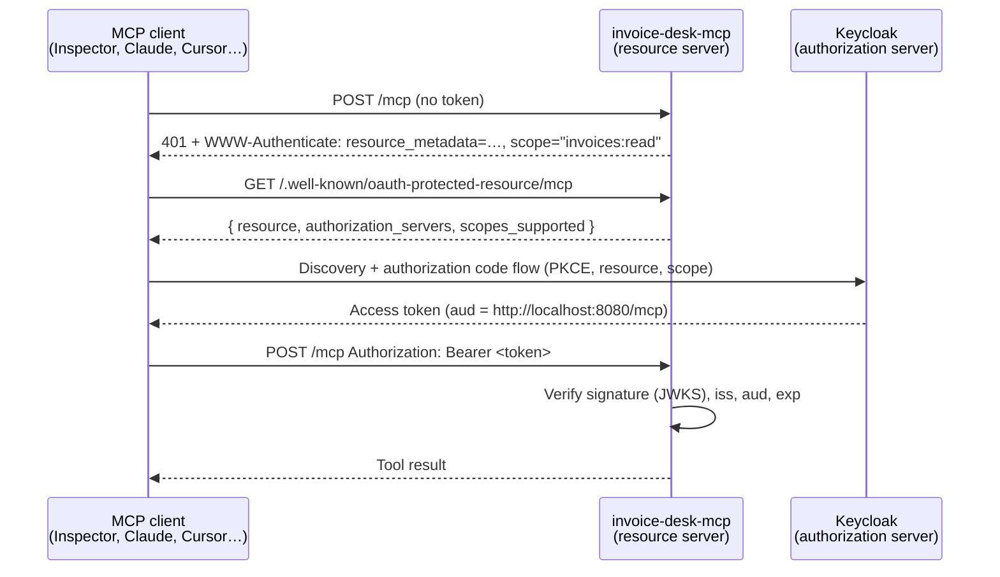

# invoice-desk-mcp

**An OAuth 2.1-protected MCP server in Java, built the way the MCP authorization spec says it should be.**

`invoice-desk-mcp` is a small [Model Context Protocol](https://modelcontextprotocol.io) server for a fake invoicing system, written with **Micronaut** and secured with **standards-based OAuth**. It's the reference implementation for my blog series **"Auth for Agents: Building a Secure MCP Server in Java."** Each part of the series adds a security layer and ships as a tagged release.

Most MCP auth examples are in TypeScript or Python. This one is for Java teams who want to put an MCP server in front of real data without giving AI agents a skeleton key.

> 📝 **Blog series:** [Part 1: Your MCP Server Is an OAuth Resource Server Now](https://medium.com/@shwetashivangi8/your-mcp-server-is-an-oauth-resource-server-now-f254dc37585f?sharedUserId=shwetashivangi8) · [Part 2: Building a Protected MCP Server in Micronaut](TODO-link)

---

## What it does

| Capability | Spec / standard | Status |
|---|---|---|
| MCP server over Streamable HTTP with an invoice tool | MCP | ✅ |
| Protected Resource Metadata at `/.well-known/oauth-protected-resource` | RFC 9728 | ✅ |
| `401` + `WWW-Authenticate` challenge pointing clients to the metadata | RFC 6750, RFC 9728 | ✅ |
| JWT validation: signature (JWKS), issuer, expiry | OAuth 2.1 | ✅ |
| **Audience validation**: tokens minted for other APIs are rejected | RFC 8707, MCP spec | ✅ |
| Provider-neutral config: Keycloak by default, Auth0 via env vars | n/a | ✅ |
| Per-tool scopes + `403 insufficient_scope` challenges | RFC 6750 | 🔜 Part 3 |
| Step-up MFA before an agent can issue a refund | RFC 9470 | 🔜 Part 4 |
| Downstream API calls without token passthrough | RFC 8693 | 🔜 Part 5 |
| Audit logging for agent actions | n/a | 🔜 Part 7 |

## How it works



The MCP server never issues tokens or handles passwords. It is a pure **OAuth resource server**, exactly the role the [MCP authorization spec](https://modelcontextprotocol.io/specification/2026-07-28/basic/authorization) gives it.

## Tech stack

- **Java 25** · **Micronaut 5.2** · `micronaut-mcp` (Streamable HTTP)
- **Micronaut Security JWT** for token validation
- **Keycloak 26** in Docker Compose as the local authorization server
- **JUnit 5** + Nimbus JOSE for auth tests that run without Keycloak

---

## Quickstart

**Prerequisites:** Java 25, Docker Desktop, and (optionally) Node.js 20+ for MCP Inspector.

```bash
git clone https://github.com/ShwetaShivangi/invoice-desk-mcp.git
cd invoice-desk-mcp/invoice-desk-mcp

# 1. Start Keycloak and create the realm, scopes, clients and a test user
docker compose up -d
./keycloak/setup-realm.sh

# 2. Run the MCP server (dev = validate tokens against Keycloak's JWKS)
MICRONAUT_ENVIRONMENTS=dev ./gradlew run
```

The server is now at `http://localhost:8080/mcp`, and Keycloak is at `http://localhost:8180` (admin / admin).

### Try it

```bash
# Discovery: public
curl -s http://localhost:8080/.well-known/oauth-protected-resource/mcp | jq

# No token: 401 with a challenge
curl -si -X POST http://localhost:8080/mcp -H 'Content-Type: application/json' \
  -d '{"jsonrpc":"2.0","id":1,"method":"tools/list"}' | head -3

# Get a token for this server and call a tool
TOKEN=$(curl -s http://localhost:8180/realms/invoice-desk/protocol/openid-connect/token \
  -d grant_type=client_credentials -d client_id=cli-tester \
  -d client_secret=dev-only-cli-tester-secret -d scope=invoices:read | jq -r .access_token)

curl -s -X POST http://localhost:8080/mcp \
  -H 'Content-Type: application/json' -H 'Accept: application/json, text/event-stream' \
  -H "Authorization: Bearer $TOKEN" \
  -d '{"jsonrpc":"2.0","id":2,"method":"tools/call","params":{"name":"listInvoices","arguments":{}}}'
```

### The skeleton-key test

Request a token with `scope=reports:read` instead. It's issued by the same Keycloak realm with a valid signature, but its audience is a *different* API. The server rejects it with `401`, and that's the vulnerability audience validation exists to stop.

---

## Testing

```bash
./gradlew test       # auth tests: no token, valid, wrong audience, wrong issuer, expired, metadata
```
The unit/integration tests sign their own tokens with a test-only key, so they run fast and need no Keycloak. They're CI-friendly.

## Configuration

Everything that differs between environments or providers is an environment variable:

| Variable | Default (local Keycloak) |
|---|---|
| `MCP_RESOURCE_URI` | `http://localhost:8080/mcp` |
| `OAUTH_ISSUER` | `http://localhost:8180/realms/invoice-desk` |
| `OAUTH_JWKS_URI` | `http://localhost:8180/realms/invoice-desk/protocol/openid-connect/certs` |

`MCP_RESOURCE_URI` must match **exactly** what your identity provider puts in the token's `aud` claim. Issuer matching is exact too, so watch out for trailing slashes.

### Using Auth0 instead of Keycloak

No code changes are needed:

1. Create an Auth0 **API** whose Identifier is your `MCP_RESOURCE_URI`, with an `invoices:read` permission.
2. Under **Settings → Advanced**, enable the **Resource Parameter Compatibility Profile**, so Auth0 honors the RFC 8707 `resource` parameter MCP clients send. Optionally also enable **Include Issuer in Authorization Responses** (RFC 9207).
3. Run with:
   ```bash
   export OAUTH_ISSUER="https://<tenant>.us.auth0.com/"     # note the trailing slash
   export OAUTH_JWKS_URI="https://<tenant>.us.auth0.com/.well-known/jwks.json"
   MICRONAUT_ENVIRONMENTS=dev ./gradlew run
   ```

---

## Project layout

```
invoice-desk-mcp/
├── docker-compose.yml                 # Keycloak (dev mode)
├── keycloak/setup-realm.sh            # realm, audience-mapped scopes, clients, test user
└── src/
    ├── main/java/com/invoicedesk/
    │   ├── InvoiceTools.java          # MCP tools
    │   ├── InvoiceRepository.java     # in-memory data
    │   └── auth/
    │       ├── ResourceServerConfig.java
    │       ├── ProtectedResourceMetadata.java
    │       ├── ProtectedResourceMetadataController.java   # RFC 9728 endpoint
    │       └── WwwAuthenticateChallengeFilter.java        # 401 challenge
    ├── main/resources/
    │   ├── application.yml            # security rules, issuer + audience validation
    │   └── application-dev.yml        # JWKS from the identity provider
    └── test/java/com/invoicedesk/
        ├── AuthTest.java              # the failure paths that matter
        └── TestTokens.java
```

## Security notes

- **Local dev only:** the Keycloak admin password, the `cli-tester` secret and the `alice` user are for local development. Never reuse them anywhere else.
- **No shared-secret signing in main config.** Micronaut Launch generates an HS256 `secret.generator` setting with a default value. It's deliberately removed here: with both a shared secret and JWKS configured, Micronaut accepts tokens signed by either, so anyone who knew the default secret could mint tokens.
- **Tokens only in the `Authorization` header.** Query-string tokens are not supported, per the MCP spec.

## Roadmap

- [x] **v0.1:** open MCP server with an invoice tool
- [x] **v0.2:** OAuth resource server: PRM, 401 challenge, issuer and audience validation
- [ ] **v0.3:** one tool, one scope: `403 insufficient_scope` and incremental consent
- [ ] **v0.4:** step-up MFA before `issue_refund`
- [ ] **v0.5:** calling downstream APIs with token exchange (no passthrough)
- [ ] **v0.6:** prompt-injection demo and mitigations
- [ ] **v0.7:** audit logging and OpenTelemetry
- [ ] **v1.0:** threat model and hardening

## References

- [MCP Authorization specification (2026-07-28)](https://modelcontextprotocol.io/specification/2026-07-28/basic/authorization)
- [Keycloak: Integrating with MCP](https://www.keycloak.org/securing-apps/mcp-authz-server)
- [RFC 9728: OAuth 2.0 Protected Resource Metadata](https://datatracker.ietf.org/doc/html/rfc9728)
- [RFC 8707: Resource Indicators for OAuth 2.0](https://www.rfc-editor.org/rfc/rfc8707.html)
- [Micronaut MCP documentation](https://docs.micronaut.io/5.1.x/mcp/)

## Author

**Shweta Shivangi**: senior software engineer specializing in authentication, authorization and identity systems.
[GitHub](https://github.com/ShwetaShivangi) · [Medium](https://medium.com/@shwetashivangi8) · [LinkedIn](https://www.linkedin.com/in/shweta-shivangi/)

Feedback and issues are welcome. If this helped you secure an MCP server, a ⭐ helps others find it.
